<div align="center">

# Poko

**A palm-sized, phone-free companion: the things you'd pick up your phone for, without picking up your phone.**

A round 240×240 display, one rotating ring, a haptic motor, a microphone and BLE to an iPhone app.
It snaps onto the back of the phone like a MagSafe accessory, or comes off and stands in for the phone at the gym, the library or on a walk.

`nRF52840` · `Zephyr / nRF Connect SDK` · `LVGL` · `BLE` · `MCUboot OTA` · `SwiftUI` · `Fusion 360 API` · `KiCad` · `JLCPCB`

<br>

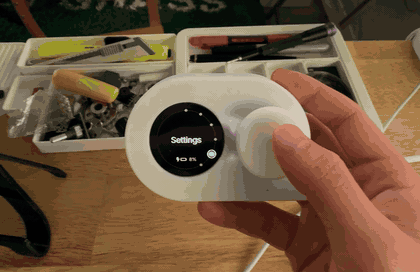
&nbsp;
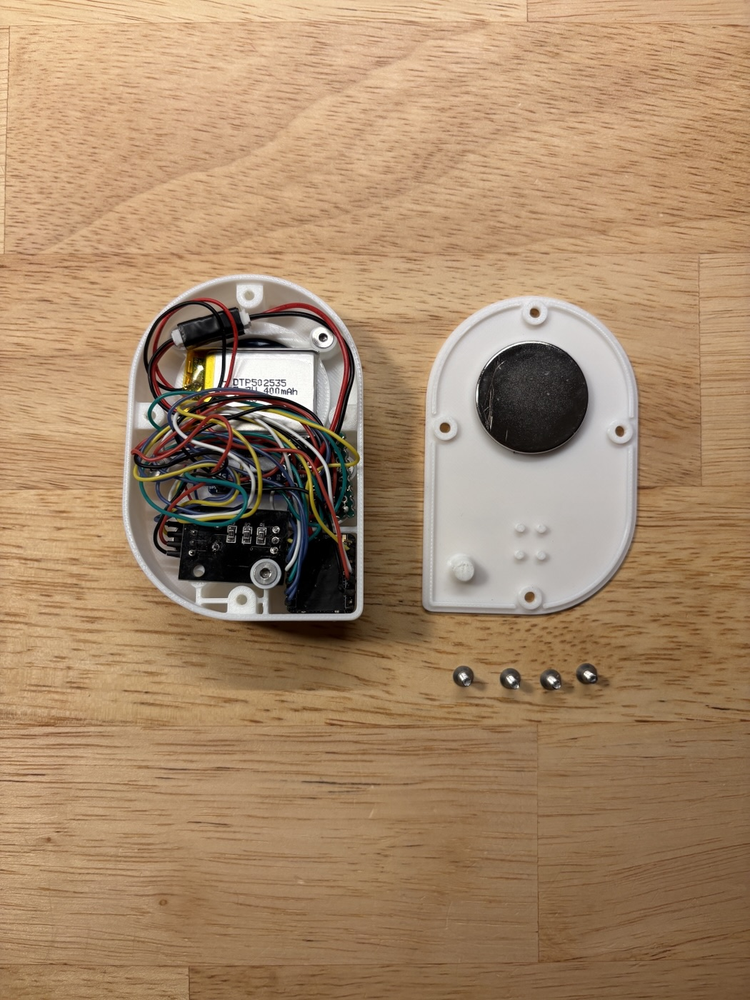

<sub>Left: breadboard prototype, wheel-driven Pomodoro → timer → voice memo (2.2× speed). Right: printed V1B enclosure with the magnet in the back cover.</sub>

</div>

---

## Contents

- [What it does](#what-it-does)
- [Requirements I've locked](#requirements-ive-locked)
- [System architecture](#system-architecture)
- [Hardware](#hardware)
- [Firmware](#firmware)
- [iPhone companion app](#iphone-companion-app)
- [Measured results](#measured-results)
- [Design direction](#design-direction)
- [Where it came from: Pokodoro (v0)](#where-it-came-from-pokodoro-v0)
- [Status and roadmap](#status-and-roadmap)
- [Repo map](#repo-map)
- [How this was built](#how-this-was-built)

---

## What it does

| | Use case | On the device | On the phone |
|---|---|---|---|
| ⏱ | **Pomodoro focus timer** | Ring sets the time, haptic ticks while turning, glanceable progress ring, silent vibration at the end | none |
| 🏋️ | **Workout tracker** | Today's exercises, the weight prefilled from last time with plates per side, rest timer, every set saved to flash | Routines are edited in the app and synced |
| 🎙 | **Voice memos** | Hold to record from any screen; ADPCM to on-board flash; works offline | Pulled over BLE, transcribed, titled and routed to Reminders, groceries or Calendar |
| 🎵 | Now Playing *(extra)* | Play/pause/skip and 16-step volume over Apple Media Service | none |
| ⌨️ | Desk keyboard *(extra)* | USB/BLE HID: ring as a scroll wheel, voice-to-typing | Transcription |

**What it won't do:** show notifications, run feeds, or ask you to scroll. One hand, eyes-free, every action confirmed by vibration.

---

## Requirements I've locked

These are the constraints every hardware and firmware decision is checked against. Full reasoning is in [`SPEC.md`](SPEC.md) and the part-by-part tracker [`docs/hardware/LOCK.md`](docs/hardware/LOCK.md).

### Product

| Requirement | Target |
|---|---|
| Form factor | MagSafe-style accessory, 60 × 90 mm outline, half-round top |
| Thickness | **8–9 mm** for production (the printed prototype is 18.8 mm; this is the hardest constraint) |
| Interaction | One hand, eyes-free. Turn moves focus, click commits; turning never silently changes a value |
| Navigation depth | Home → app → one detail level, max. Apps live at fixed clock positions on the home ring |
| Battery | Lasts a normal day; ~0.5 mA sleep-floor target |
| Offline | Device works without the phone; the phone does the heavy lifting (transcription, sync) |
| Manufacturing | Every part sourceable at ~100 units, JLC-assemblable, no injection mold for the first run |
| Prototyping rule | Internals must be printable (PLA/TPU) or stock commodity parts; dimensions tunable by reprint |
| Access rule | Every prototype breaks out spare GPIOs, 3V3/GND and an outside-reachable reset |

### Hardware decisions

| Subsystem | Decision | Why |
|---|---|---|
| MCU | **nRF52840**: XIAO Sense on a carrier board for the first batch, Raytac MDBT50Q module for production | BLE + battery life over the ESP32-S3 used in v0; the module is ~1.5–3 mm thinner and ~$6 cheaper than soldering down a dev board |
| Display | **1.28" round GC9A01 TFT**, 240×240, 4-wire SPI, bare 16-pin FPC panel | Round AMOLED was RFQ-only with ~1,000 MOQ; TFT has transparent low-volume pricing. Cost: the backlight dominates power, so it gets a discrete constant-current sink with PWM |
| Input | **Rotating ring + mechanical select**, AS5600 magnetic angle sensor on-axis | EC11 encoders are too thick for 8 mm. Optical, magnetic strip, inductive PCB coil and capacitive were weighed, and the press-sensing options were tested on rigs (see [Hardware](#hardware)) |
| Haptics | **LRA + DRV2605L**; detents simulated in software | One actuator gives detents, clicks and alerts with no mechanical detent to wear out or add thickness |
| Power | 500 mAh 303450 LiPo (3.0 mm thick), single-cell linear charger | Chosen to protect the thickness budget; battery life comes from backlight PWM and a low sleep floor |
| Storage | 16 MB QSPI NOR flash on the production board (memos + OTA slot), no SD card | About 31 minutes of memos alongside a full OTA image |
| Firmware | **Zephyr / nRF Connect SDK** | Real power management, MCUboot signed OTA, BLE stack. Arduino and CircuitPython were used only for bring-up |
| Enclosure | Machined shell (quote pending) with 3D-printed internals | Small batch; no mold until demand is proven |

---

## System architecture

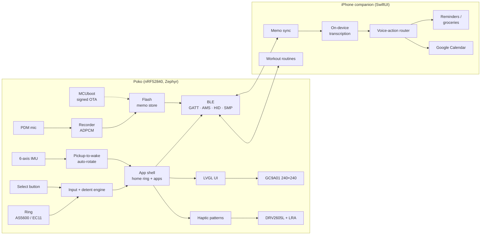

---

## Hardware

### Prototype progression

| Stage | What | Status |
|---|---|---|
| **Breadboard bring-up** | XIAO nRF52840 Sense + round GC9A01 module + EC11 encoder (detent removed, shaft cut down) + ERM motor. CircuitPython first, then Zephyr | Done (Sept 2026) |
| **Enclosure V1B** | Two-part printed shell, 33 mm thumb wheel, display retainer, VHB-mounted XIAO, magnet in the back cover, support-free print orientations. 18.8 mm thick | Printed, carried daily to the gym and library |
| **Enclosure V2 (inset)** | Parametric Fusion 360 model driven from Python ([`cad/enclosure_v2_inset.py`](cad/enclosure_v2_inset.py)): 8 mm stack, datum-based [tolerance stack](docs/hardware/tolerance-stack.md), pairwise interference checks | Modelled |
| **Knob and ring test rigs** | Printed rigs + an ESP32-S3 logger streaming AS5600 angle/AGC/magnitude at 100 Hz to a Web Serial visualizer | Built and tested, see below |
| **XIAO carrier PCB** | Chin board carrying the display FPC, AS5600, DRV2605L/LRA, backlight sink, select-switch footprints | Next: floorplan → schematic → JLC order |

<table>
<tr>
<td align="center">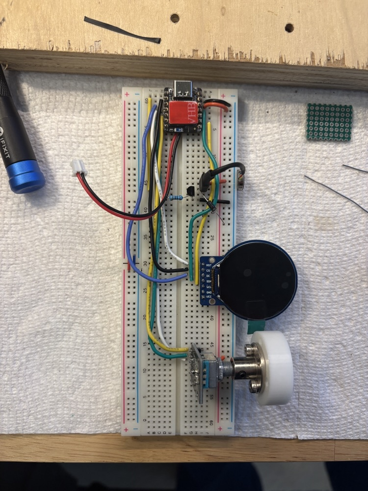<br><sub>Breadboard bring-up</sub></td>
<td align="center">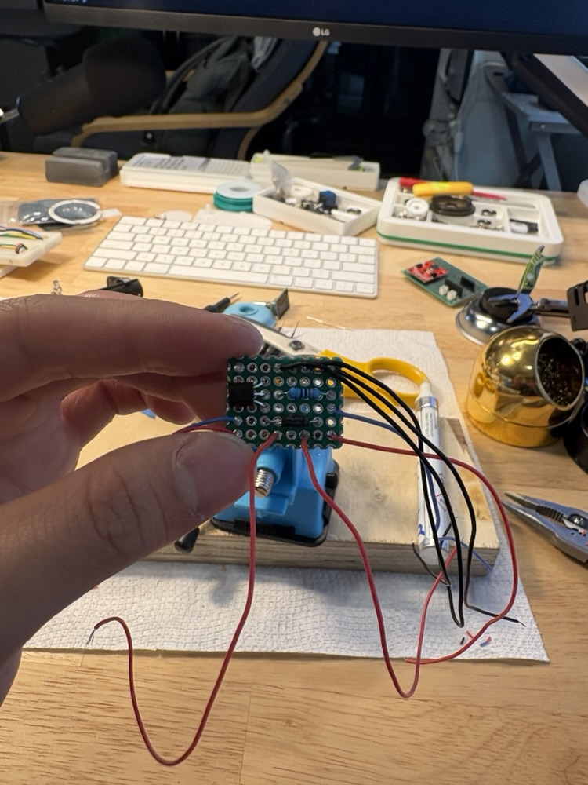<br><sub>Protoboard for the first enclosure</sub></td>
<td align="center">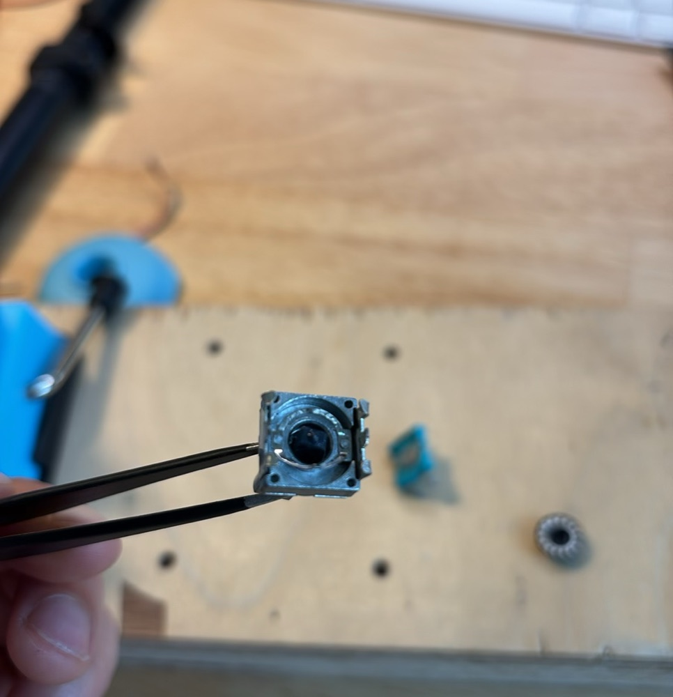<br><sub>EC11 opened to remove the detent spring</sub></td>
<td align="center">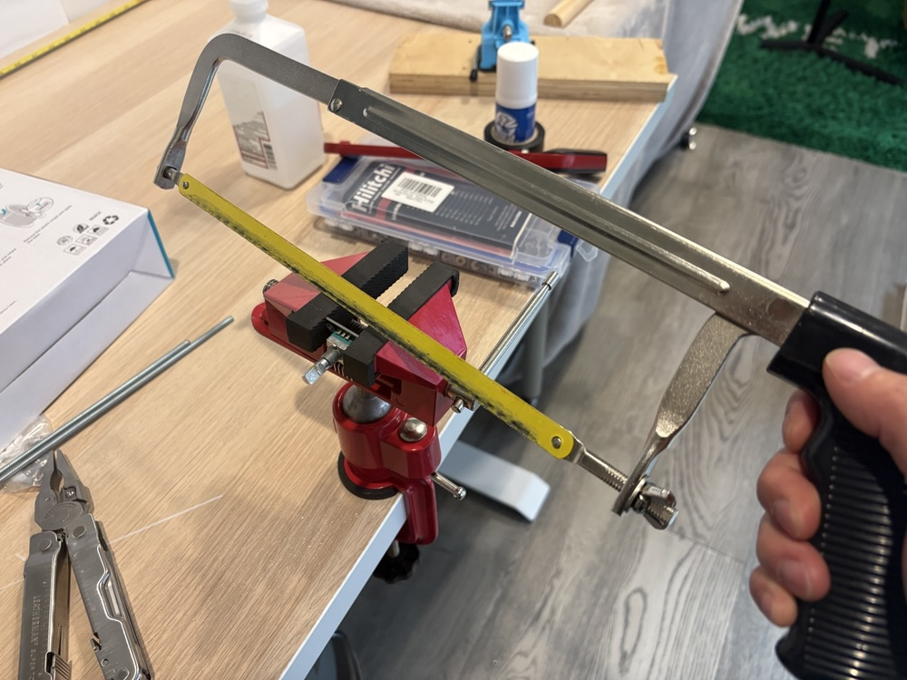<br><sub>Cutting the encoder shaft down</sub></td>
</tr>
</table>

### Ring input: what the rigs showed

The ring has to feel premium (the iPod click wheel is the reference) inside an 8 mm stack, so I built rigs and measured before committing:

- **Friction roller → AS5600:** worked, but felt overcomplicated and thin. Set aside.
- **Whole-knob press detected from magnet field strength (AS5600 AGC):** at a ~1 mm gap, rest AGC was 68–76 and a centre press dropped it to 32–37. A detector ("AGC drops ≥ 25 below the 3 s peak, held 150 ms, rotation < 4°") replayed 3/3 centre presses, 3/3 edge presses and 0 false triggers on turns.
- **Trackpad-style ring (≈0.05 mm travel, printed cantilever springs, 45° flare retention):** the thumb's grip while only rotating (AGC 24–35) overlapped edge presses (25–29). One sensor couldn't separate them reliably.
- **Decision:** AS5600 on-axis for rotation + a thin mechanical tact switch for select, with three switch footprints and spare I2C/GPIO on the carrier so the mechanism can change without a board respin.

Scripts: [`cad/as5600_knob_rig.py`](cad/as5600_knob_rig.py), [`cad/ring_rig.py`](cad/ring_rig.py), [`firmware/tools/as5600_rig/`](firmware/tools/as5600_rig) (logger firmware + visualizer).

### Electrical design notes

- **Backlight sink:** AO3400A + TLV9001 constant-current loop, 2.2 Ω sense, PWM-derived reference, op-amp powered from a GPIO so it draws nothing in sleep, gate pull-down for the unpowered state.
- **Charger swap check:** MCP73831 → TP4054. The check caught that the MCP73831's STAT pin drives ~4.6 V into a 3.0 V GPIO, and that the TP4054 PROG formula changes above 150 mA. Details in [`docs/hardware/LOCK.md`](docs/hardware/LOCK.md).
- **Pin budget:** all 11 XIAO pads allocated (SPI display, shared I2C for AS5600 + DRV2605L, select, backlight PWM/enable), one spare, with solder jumpers for optional lines ([`docs/hardware/pins.md`](docs/hardware/pins.md)).
- **Supply chain:** JLC quoted the Raytac module at **$15.69** vs. its own $7.73 list price and $6.50–7.13 at TME. At 100 units that gap is ~$840, so volume orders point to sourcing it elsewhere. Assembly-tier costs are in [`docs/hardware/jlc-cost.md`](docs/hardware/jlc-cost.md).

---

## Firmware

A Zephyr application split into a small OS layer and apps (source in a private repo; happy to walk through it):

- **`os/`**: input (EC11 Gray-code decoder, AS5600 driver), detent and haptic engine, LVGL screen and widgets, power states (dim, sleep, pickup-to-wake from the IMU), battery ADC, PDM capture with ADPCM, NVS-backed memo store, BLE link (custom GATT, Apple Media Service, HID keyboard), USB HID, MCUboot OTA, crash capture.
- **`apps/`**: Pomodoro, Gym (with synced routines), Voice memos, Now Playing, Desk keyboard, Settings.
- **Tooling:** a bench build that measures frame time, a power-test app for current measurements, a memo-pull script, and a desktop LVGL simulator.

Each feature was specced as a numbered brief with acceptance criteria and an outcome write-up.

---

## iPhone companion app

SwiftUI app (XcodeGen project, source in the same private repo): memo sync over BLE, on-device transcription, automatic titles, a voice-action router (to-dos, groceries, Google Calendar via OAuth PKCE), and workout routine editing. A routing eval harness scores the router against synthetic and real memo sets.

---

## Measured results

| What | Result | How |
|---|---|---|
| Current, screen off / on / recording | 37.5 / 42.6 / 44.0 mA | Multimeter in series with the battery, USB unplugged ([`power.md`](docs/hardware/power.md)) |
| Backlight share of screen-on draw | 33.5 mA (~79%) | Voltage across the module's 8.2 Ω backlight resistor. This is why the production board gets a PWM current sink |
| OTA over BLE | 561 KB in ~34 s, 42.5 s swap | MCUboot. A battery pull mid-swap recovered, and all 105 stored memos kept matching CRCs ([`ota-checks.md`](docs/hardware/ota-checks.md)) |
| Boot time | 53 s → **4.4 s** | Traced to a per-key NVS walk at boot, replaced with a single pass |
| Voice-to-text, release to typed | 5.9–6.3 s → ~3.0–3.7 s | Timing marks on device and phone, 5–7 s utterances |
| Voice-action routing accuracy | 47/54 → **52/54** on real memos | Eval harness, Apple on-device model |
| Album-art decode | 65 ms avg / 167 ms max | Measured, then cut: it made the UI lag |

---

## Design direction

<table>
<tr>
<td width="45%">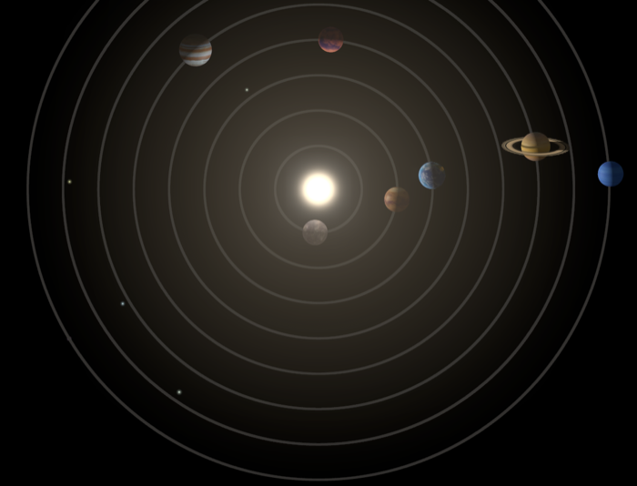</td>
<td>

**Inspiration:** concentric orbits on black, like the iOS Solar System lock screen. They map naturally onto a round display and a ring you turn.

- Black background, thin white line art, **one accent colour**
- Thick arc progress rings for timers
- Apps sit at fixed clock positions; only the focus moves, so you can go straight to one ("gym is at 2")
- Cheap pixels: small objects move over static, rotationally symmetric backgrounds, with no full-screen redraws
- Every turn and click confirmed by haptics, so it works without looking

</td>
</tr>
</table>

---

## Where it came from: Pokodoro (v0)

Poko is the second version of a device I started in 2024: **Pokodoro**, a portable Pomodoro timer that tells you a session is over with a vibration instead of a beep, so it works in a library or an office. I sketched it, prototyped it on protoboard, laid out a 4-layer board in KiCad, had it fabricated, hand-soldered it and designed the enclosure.

<table>
<tr>
<td align="center">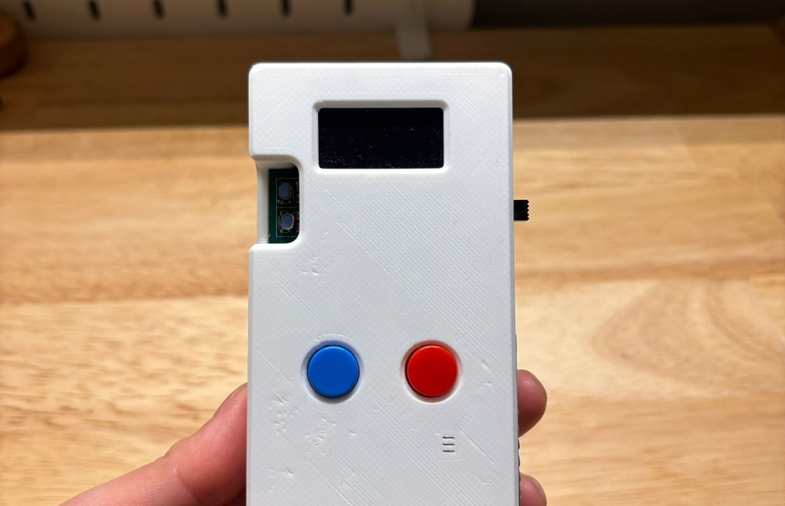<br><sub>Assembled v0</sub></td>
<td align="center">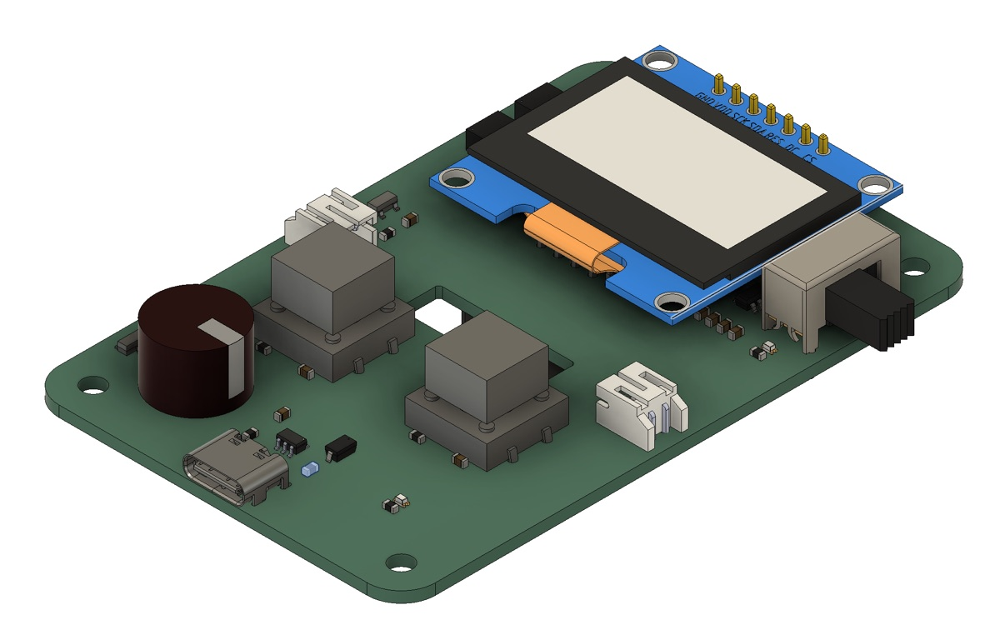<br><sub>Custom PCB (KiCad 3D)</sub></td>
<td align="center">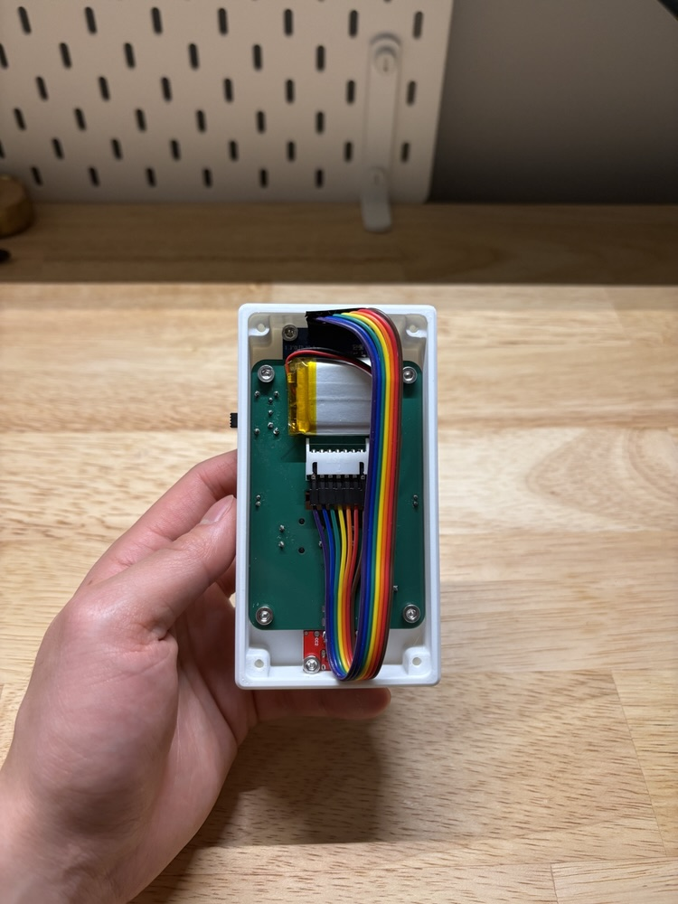<br><sub>Inside the enclosure</sub></td>
</tr>
<tr>
<td align="center">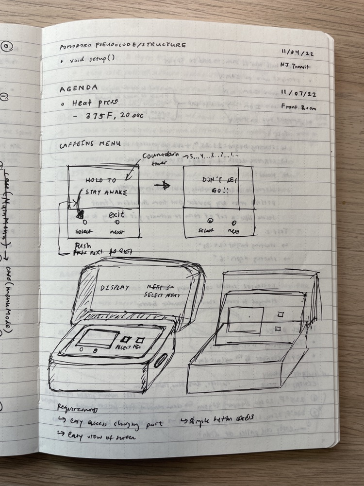<br><sub>UI sketches</sub></td>
<td align="center">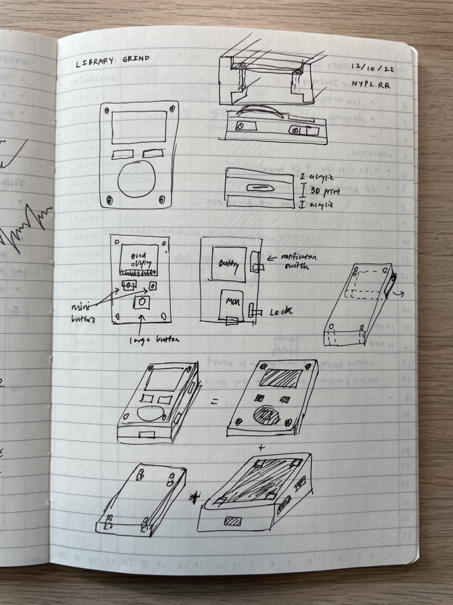<br><sub>Enclosure sketches</sub></td>
<td align="center">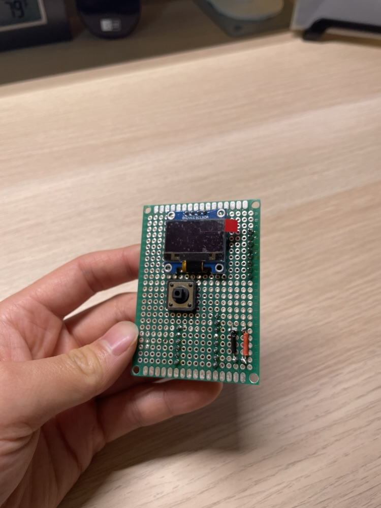<br><sub>Protoboard MVP</sub></td>
</tr>
</table>

**Board:** ESP32-S3-WROOM-1, USB-C with a TVS ESD array, MCP73831 LiPo charger, Schottky OR-ing of USB and battery into a MIC5219 LDO, transistor-driven vibration motor and buzzer, SPI OLED header, two user buttons plus boot/reset. KiCad sources, Gerbers, BOM and placement files are in [`pokodoro/`](pokodoro/Pokodoro).

<details>
<summary>Schematic and copper layout</summary>
<br>
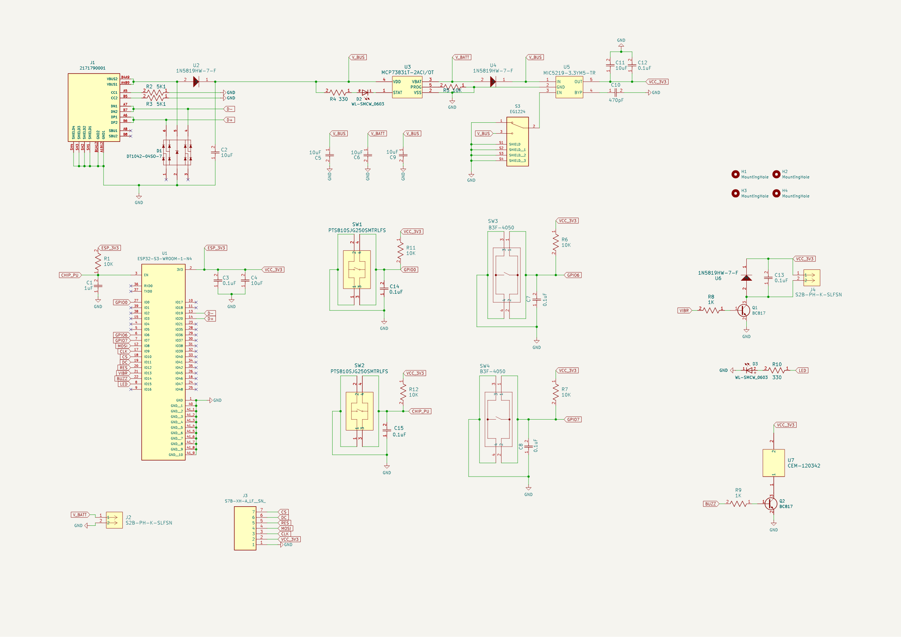
<br><br>
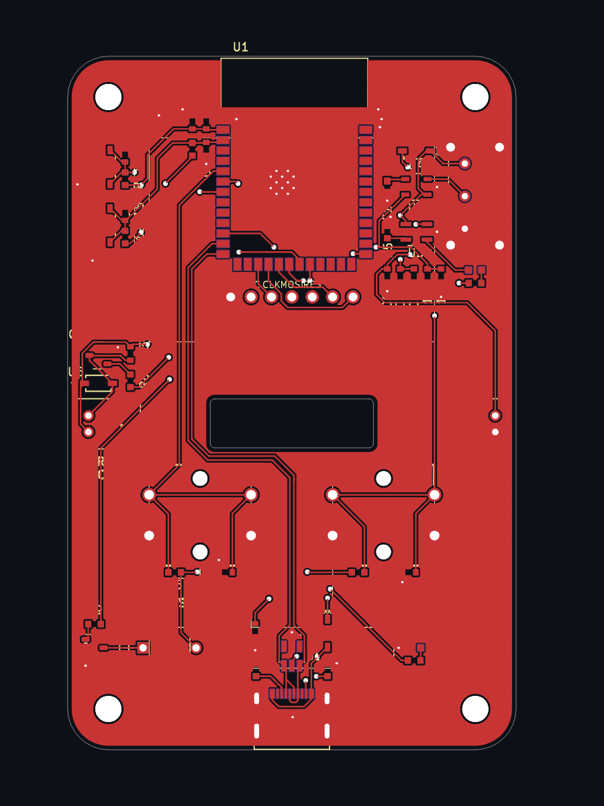
</details>

**What changed in Poko:** the MCU went to nRF52840 for BLE and battery life, a round colour display replaced the 128×64 OLED, a haptic ring replaced the buttons, the firmware moved to Zephyr with OTA and a phone app, and the scope grew from a timer into something to carry every day.

---

## Status and roadmap

**Current goal: a lendable batch of 7 units**, polished enough to hand to 3–5 people for two weeks of real use (Pomodoro, workouts, memos).

- [x] Firmware for all core apps running on the prototype, OTA proven
- [x] iPhone app: sync, transcription, routing, routines
- [x] Power measured, battery and backlight strategy set
- [x] Display, haptics and USB parts locked; samples ordered
- [x] Ring sensing decided after rig testing
- [ ] Mechanical select-switch jig (force vs. grip)
- [ ] XIAO carrier PCB: floorplan → schematic → layout → JLC assembly
- [ ] Enclosure V2 ring area rework, machining quote for 7
- [ ] Batch-1 build, lend, write up feedback
- [ ] Then: Raytac custom board, 100-unit quotes, preorder

---

## Repo map

```
SPEC.md                  concept, requirements, early BOM and power budget
docs/hardware/           part lock tracker, pins, power, haptics, OTA, tolerance stack, JLC cost
docs/images/             photos, demo GIF, KiCad exports
cad/                     parametric Fusion 360 scripts: enclosure, floorplan, test rigs, 3MF export
firmware/tools/as5600_rig/  ring-rig logger (ESP32-S3) + Web Serial visualizer and menu tests
pokodoro/                the v0 KiCad project (schematic, PCB, Gerbers, BOM)
```

Firmware (Zephyr, C) and the iPhone app (SwiftUI) are in a private repo and available on request.

---

## How this was built

I'm the sole developer. I set the requirements, made the hardware and part decisions, sourced parts and talked to suppliers, and built, printed and bench-tested every prototype and rig. Pokodoro (v0) I designed end to end myself. For Poko, most of the firmware, iOS and CAD-script code was written with AI coding agents (Claude Code) working from feature briefs. I wrote each brief's requirements, tested the results on real hardware, and accepted or rejected them.
